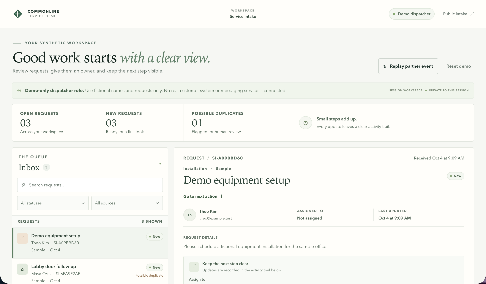

# Ed Hernandez

### Software, workflow automation and observable systems

I turn operational problems into practical applications, with clear interfaces, traceable decisions and reproducible checks. My work combines operations experience with AI assisted development.

[Explore the selected projects below](#selected-work) · [All repositories](https://github.com/bullyopswork?tab=repositories)

## Selected work

### 1. [Azure Recovery Lab](https://github.com/bullyopswork/azure-recovery-lab)

**Can a cloud service detect an unhealthy process and recover without a manual restart?**

A Python service, container health probes, Terraform and GitHub OIDC make the experiment observable. One controlled Azure trial recovered to a different healthy process in the same replica. The **43.158 second** measurement includes CLI setup and polling, not just restart time. All temporary lab infrastructure and scoped permissions were independently verified removed. Final billing remains unposted.

**Decision:** use one replica and a fault bound to one boot identity, so downtime and the platform's restart can be distinguished from a redeployment.

[28 second recorded data replay](https://github.com/bullyopswork/azure-recovery-lab/blob/main/demo/Recovery-Results.mp4) · [Evidence](https://github.com/bullyopswork/azure-recovery-lab/blob/main/docs/EVIDENCE.md) · [Source](https://github.com/bullyopswork/azure-recovery-lab)

### 2. [Cited Change Analyzer](https://github.com/bullyopswork/cited-change-analyzer)

**What changed in these documents, and where is the supporting text?**

An installable Python and TypeScript tool for local TXT and selectable text PDF comparisons, exact citations, PDF page provenance and report exports. The released package includes its browser interface. Local comparison needs no API key; optional AI uses the installer's own key with explicit consent.

**Decision:** keep source alignment separate from AI explanation, and preserve local findings if a provider fails. The public demo is a static example archive, not an upload service.

[Example archive](https://bullyopswork.github.io/cited-change-analyzer/) · [Install v0.2](https://github.com/bullyopswork/cited-change-analyzer/releases/tag/v0.2.0) · [34 document checks](https://github.com/bullyopswork/cited-change-analyzer/blob/main/data/evaluation/local-documents-v02.json)

### 3. [Service Intake Workbench](https://github.com/bullyopswork/service-intake-workbench)

**How does a public request become traceable staff work without duplicate ingestion?**

A deployed Next.js, React, TypeScript and PostgreSQL application with intake, assignment, resolution, activity history and signed webhook ingestion. The public walkthrough uses fictional information and isolated demo workspaces, not real customer operations.

**Decision:** serialize webhook replay keys in a database transaction, and commit workflow changes with their activity events. The demo dispatcher role is not production authentication.

[Live demo](https://service-intake-workbench.vercel.app/) · [Source](https://github.com/bullyopswork/service-intake-workbench) · [Integration checks](https://github.com/bullyopswork/service-intake-workbench/actions)

### 4. [Closeout: Proof of Handoff](https://github.com/bullyopswork/closeout-proof-of-handoff)

**How do we keep stale evidence from becoming false completion?**

A responsive JavaScript interface for reviewing synthetic construction evidence, staging a precise proposal and requiring a visible human decision before one time application. The ordinary browser demo shows Preview mode; full application uses a compatible WebMCP surface.

**Decision:** bind approval to the exact payload, page generation and evidence, then reject token replay. Unresolved exceptions keep handoff blocked.

[Live preview](https://closeout-proof-of-handoff.vercel.app/) · [Walkthrough](https://youtu.be/juAD0BmmExc) · [Browser proof](https://github.com/bullyopswork/closeout-proof-of-handoff/blob/main/VERIFICATION.md)

## More work

1. [TracePilot Review Console](https://github.com/bullyopswork/tracepilot-review-console): a synthetic full stack review workspace, separate from live agent execution. [Demo](https://tracepilot-review-console.vercel.app/).
2. [TracePilot](https://github.com/bullyopswork/tracepilot): Python agent diagnostics with Google ADK, Gemini and Phoenix tracing. [Proof workflow](https://github.com/bullyopswork/tracepilot/blob/main/proof_gate/README.md).
3. [Excel Payment Reconciliation](https://github.com/bullyopswork/excel-payment-reconciliation): a reproducible Python workflow for cleaning exports, matching payments and flagging exceptions in a sample workbook.

## Private business application

**All County Court Notification App:** built and deployed a Node.js, TypeScript, PostgreSQL and Prisma application for court notice intake, document extraction, case evidence and staff review. Delivered a six page dashboard with protected access, an audit trail and Twilio notification integration. Source and client records remain private.

## How I work

I use AI tools during development and review. The repositories show the resulting implementation and verification; ownership is not a claim that every line was personally handwritten. Demonstrations, local checks, agent reviewed evaluations and live cloud results are labeled separately.

Interested in web development, workflow automation, QA and application support. Explore a project, inspect its evidence and [find me on GitHub](https://github.com/bullyopswork).
